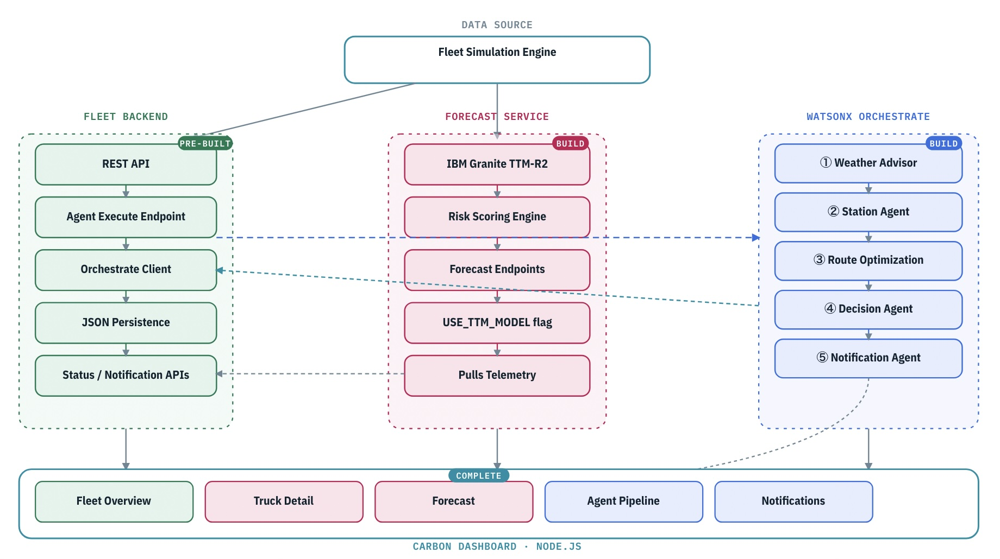

# LAB-2752 — Build Reusable Agentic AI Patterns for Cold Chain

## Predictive & Autonomous Workflows · IBM TechXchange 2026

---

Cold-chain logistics is no longer just a transportation problem — it is an operational risk management challenge where timing is everything. When a temperature breach, a storm, and a cooling system fault converge on the same truck, an operator has minutes to act.

In this lab you will build the intelligence layer of a cold-chain fleet platform using **IBM Bob** and IBM AI building blocks. The fleet backend is already running in your environment. Your job is to build three things on top of it — guided entirely by IBM Bob.

---

## What You Will Build



| Component | Your Role | Bob Mode |
|---|---|---|
| **Fleet Backend** | Pre-built — explore and verify | Agent mode |
| **Forecast Service** | Build from scratch | 🔮 TTM Forecasting mode |
| **watsonx Orchestrate** | Build 5 agents + Python tools | 🚛 FleetOps Agent Builder mode |
| **Carbon Dashboard** | Complete the data bindings | Agent mode |

---

## Lab Structure

| Lab | Folder | What You Do |
|---|---|---|
| **Lab 0** | [`00-setup/`](./00-setup/README.md) | Environment setup, credentials, Bob modes |
| **Lab 1** | [`01-fleet-backend/`](./01-fleet-backend/README.md) | Explore the pre-built backend, verify APIs, run mock pipeline |
| **Lab 2** | [`02-forecast-service/`](./02-forecast-service/README.md) | Build the IBM Granite TTM-R2 forecast service with Bob |
| **Lab 3** | [`03-watsonx-orchestrate/`](./03-watsonx-orchestrate/README.md) | Build 5 agents + tools, upload, wire connections |
| **Lab 4** | [`04-carbon-dashboard/`](./04-carbon-dashboard/README.md) | Complete the dashboard, run the live end-to-end pipeline |

> ⚡ **Checkpoint:** If Lab 2 fails (pip install errors or missing WML credentials), copy the pre-built service from `02-forecast-service/checkpoint/` into `forecast-backend/` and jump straight to Lab 3. Ask your instructor.

---

## Learning Objectives

By the end of this lab you will be able to:

1. Configure and start the pre-built FleetOps backend and verify its REST APIs via Swagger UI
2. Build a FastAPI temperature-forecasting service using IBM Granite TTM-R2 with IBM Bob
3. Define five watsonx Orchestrate agents and upload their Python tools using the ADK
4. Register watsonx Orchestrate connections and wire all five agent IDs to the fleet backend
5. Complete a Carbon-based live dashboard using IBM Bob in Agent mode
6. Run the end-to-end agentic pipeline on the incident truck and observe the autonomous reroute decision

---

## Prerequisites

| Requirement | Details |
|---|---|
| **IBM Bob IDE** | Installed and logged in — confirm with your instructor |
| **Python 3.12+** | `python3 --version` |
| **Node.js 18+** | `node --version` |
| **watsonx Orchestrate** | SaaS tenant URL + API key — provided by instructor |
| **Lab repository** | Cloned to your machine (this repo) |

---

## Repository Structure

```
lab-2752/
├── README.md                              ← You are here
│
├── 00-setup/
│   └── README.md                          ← Credentials, Bob modes, env files
│
├── 01-fleet-backend/                      ── PRE-BUILT ──────────────────────
│   ├── README.md                          ← Explore APIs, incident truck, mock pipeline
│   ├── .env.example                       ← Backend env template (agent IDs go here)
│   ├── config.yaml                        ← Orchestrate config
│   ├── requirements.txt
│   ├── run.sh
│   └── app/                              ← Full FastAPI source (pre-built, read-only)
│       ├── main.py
│       ├── api/          (trucks, alerts, agents, stations, weather …)
│       ├── models/       (truck, cargo, alert, route, station …)
│       ├── services/     (simulation_engine, agent_service, truck_service …)
│       └── utils/        (data_generator, geo_utils …)
│
├── 02-forecast-service/                   ── BUILD WITH BOB ─────────────────
│   ├── README.md                          ← Bob TTM mode prompt + verify steps
│   ├── .env.example                       ← USE_TTM_MODEL + WML credentials template
│   └── checkpoint/                        ← Pre-built backup (use if Lab 2 fails)
│       ├── main.py
│       ├── requirements.txt
│       ├── models/
│       └── services/
│
├── 03-watsonx-orchestrate/                ── BUILD WITH BOB ─────────────────
│   ├── README.md                          ← Lab 3 overview + Bob prompt
│   ├── 03-1-weather-station-agents/README.md
│   ├── 03-2-route-decision-agents/README.md
│   ├── 03-3-notification-wire/README.md
│   └── assets/                            ← Backup / upload-ready files
│       ├── agents/                        ← 5 agent YAML definitions
│       │   ├── weather_advisor.yaml
│       │   ├── station_agent.yaml
│       │   ├── RouteOptimizationAgent.yaml
│       │   ├── decision_agent.yaml
│       │   └── notification_agent.yaml
│       ├── connections/                   ← Connection definitions for ADK
│       │   ├── fleetops_api.yaml
│       │   └── forecast_api.yaml
│       └── tools/                         ← 5 Python tool files
│           ├── weather_forecast/weather_forecast_tool.py
│           ├── station_tool/station_search_tool.py
│           ├── RouteOptimization/route_optimizer_tool.py
│           ├── decision_tool/decision_analysis_tool.py
│           └── whatsapp_notification/whatsapp_notification_tool.py
│
├── 04-carbon-dashboard/                   ── COMPLETE WITH BOB ──────────────
│   ├── README.md                          ← Bob wiring prompt + live pipeline run
│   ├── server.js                          ← Node.js proxy server
│   ├── package.json
│   ├── .env.example
│   └── public/                            ← Dashboard frontend (wire data bindings)
│       ├── index.html
│       ├── app.js
│       ├── forecast.js
│       ├── agents.js
│       └── operations-new.js
│
└── fleetops-phase1-architecture.jpg       ← Architecture diagram
```

---

## The Incident Scenario

> A pharmaceutical cargo truck is carrying temperature-sensitive drugs on the Atlanta GA → Macon GA route (I-75). A severe weather system sits directly on the corridor. The cargo is above the 8 °C threshold. The agents you will build must analyse the situation and autonomously recommend an emergency reroute.

---

## Resources

| Resource | Link |
|---|---|
| IBM Bob | [ibm.com/products/watsonx-code-assistant](https://www.ibm.com/products/watsonx-code-assistant) |
| IBM Granite TTM-R2 | [huggingface.co/ibm-granite/granite-timeseries-ttm-r2](https://huggingface.co/ibm-granite/granite-timeseries-ttm-r2) |
| watsonx Orchestrate docs | [ibm.com/docs/en/watsonx/watson-orchestrate](https://www.ibm.com/docs/en/watsonx/watson-orchestrate) |
| IBM Carbon Design System | [carbondesignsystem.com](https://carbondesignsystem.com) |
| Community & help | [community.ibm.com/techxchange](https://community.ibm.com/techxchange) |

---

*Made with IBM Bob*
